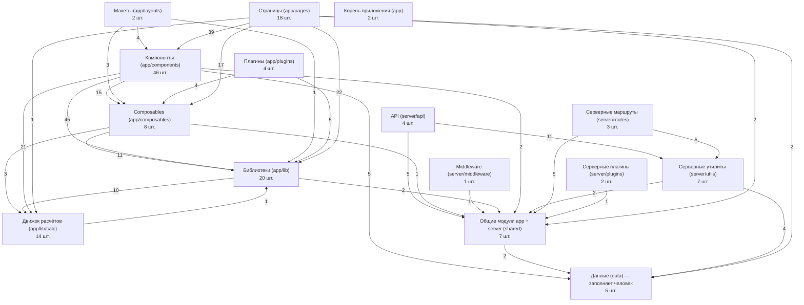

# Карта проекта keflab.ru

> Файл генерируется командой `npm run map` из кода — не править руками. CI (`npm run map:check`) падает, если карта устарела.
> Интерактивная схема зависимостей: `docs/project-map.html` (открыть в браузере).

Модулей: 143, связей: 361.

## Как пользоваться

- Ищете, где что лежит, — разделы «Страницы» и «Модули по слоям».
- Меняете модуль — посмотрите «Используется в» (прямые) или в `docs/project-map.html` — «На что повлияет» (все, кто зависит транзитивно), и проверьте эти места.
- Описание модуля — первый комментарий в начале файла: пишите его коротко и по делу.

## Слои и направления зависимостей

## Страницы

| Адрес | Файл | Основные компоненты |
| --- | --- | --- |
| `/` | [app/pages/index.vue](../app/pages/index.vue) | CalcStaticExample, CalcSystemCalculator |
| `/*/` | [app/pages/[...slug].vue](../app/pages/[...slug].vue) |  |
| `/bk/:slug/kak-schitaetsya-sistema/` | [app/pages/bk/[slug]/kak-schitaetsya-sistema.vue](../app/pages/bk/[slug]/kak-schitaetsya-sistema.vue) | Breadcrumbs, BookmakerRuleBlock, CalcSystemCalculator |
| `/chto-takoe-sistema-v-stavkah/` | [app/pages/chto-takoe-sistema-v-stavkah.vue](../app/pages/chto-takoe-sistema-v-stavkah.vue) | Breadcrumbs, ArticleFaqList, ArticleSystemTypesTable, components/article/faq.ts, components/article/examples.ts, CalcResultsCombinationsTable, CalcSystemCalculator |
| `/embed/sistema/` | [app/pages/embed/sistema.vue](../app/pages/embed/sistema.vue) | CalcSystemCalculator |
| `/kalkulyator-ekspressa/` | [app/pages/kalkulyator-ekspressa.vue](../app/pages/kalkulyator-ekspressa.vue) | CalcExpressCalculator, Breadcrumbs |
| `/kalkulyatory/` | [app/pages/kalkulyatory/index.vue](../app/pages/kalkulyatory/index.vue) | Breadcrumbs |
| `/kalkulyatory/dogon/` | [app/pages/kalkulyatory/dogon.vue](../app/pages/kalkulyatory/dogon.vue) | SmallCalcDogonCalculator, SmallCalcLayout |
| `/kalkulyatory/fribet/` | [app/pages/kalkulyatory/fribet.vue](../app/pages/kalkulyatory/fribet.vue) | SmallCalcFreebetCalculator, SmallCalcLayout |
| `/kalkulyatory/konverter-koefficientov/` | [app/pages/kalkulyatory/konverter-koefficientov.vue](../app/pages/kalkulyatory/konverter-koefficientov.vue) | SmallCalcConverterCalculator, SmallCalcLayout |
| `/kalkulyatory/marzha/` | [app/pages/kalkulyatory/marzha.vue](../app/pages/kalkulyatory/marzha.vue) | SmallCalcMarginCalculator, SmallCalcLayout |
| `/kalkulyatory/slozhenie-koefficientov/` | [app/pages/kalkulyatory/slozhenie-koefficientov.vue](../app/pages/kalkulyatory/slozhenie-koefficientov.vue) | SmallCalcSumOddsCalculator, SmallCalcLayout |
| `/o-proekte/` | [app/pages/o-proekte.vue](../app/pages/o-proekte.vue) | Breadcrumbs, LegalMediaImprint |
| `/otvetstvennaya-igra/` | [app/pages/otvetstvennaya-igra.vue](../app/pages/otvetstvennaya-igra.vue) | Breadcrumbs |
| `/politika-konfidencialnosti/` | [app/pages/politika-konfidencialnosti.vue](../app/pages/politika-konfidencialnosti.vue) | Breadcrumbs |
| `/reklama/` | [app/pages/reklama.vue](../app/pages/reklama.vue) | Breadcrumbs |
| `/sistema-:k-iz-:n/` | [app/pages/sistema-[k]-iz-[n].vue](../app/pages/sistema-[k]-iz-[n].vue) | Breadcrumbs, ArticleFaqList, CalcSystemCalculator, SystemPageNeighborsTable, SystemPageSystemExample, SystemPageWinsTable |
| `/vidzhet/` | [app/pages/vidzhet.vue](../app/pages/vidzhet.vue) | WidgetGenerator, Breadcrumbs |

## Серверные адреса

| Адрес | Файл | Описание |
| --- | --- | --- |
| `POST /api/error` | [server/api/error.post.ts](../server/api/error.post.ts) | POST /api/error: приём ошибок из браузера того же сайта, лимит 60 записей в минуту, ответ 204 без тела. |
| `GET /api/geo` | [server/api/geo.get.ts](../server/api/geo.get.ts) | GET /api/geo: страна из заголовка Nginx, значение выключателя и видимые офферы для места показа. |
| `GET /api/health` | [server/api/health.get.ts](../server/api/health.get.ts) | GET /api/health: ответ { ok: true } для мониторинга и проверки выпуска, без обращения к внешним сервисам. |
| `POST /api/stat` | [server/api/stat.post.ts](../server/api/stat.post.ts) | POST /api/stat: счётчик показов оффера по erid без cookie и IP, только для видимых офферов, ответ 204. |
| `GET /go/:id` | [server/routes/go/[id].get.ts](../server/routes/go/[id].get.ts) | GET /go/<id>: проверка оффера (срок, гео, выключатель, allowlist), учёт клика и 302 на БК, иначе 410 или 404. |
| `ANY /robots.txt` | [server/routes/robots.txt.ts](../server/routes/robots.txt.ts) | GET /robots.txt: всё разрешено, кроме /go/, и ссылка на sitemap.xml. |
| `ANY /sitemap.xml` | [server/routes/sitemap.xml.ts](../server/routes/sitemap.xml.ts) | GET /sitemap.xml: карта сайта из реестра страниц shared/site-pages с датами из lastmod.json. |

## Модули по слоям

### Страницы (app/pages)

| Модуль | Описание | Использует | Используется в |
| --- | --- | --- | --- |
| [app/pages/[...slug].vue](../app/pages/[...slug].vue) | Любой неизвестный адрес — 404 со страницей app/error.vue. |  |  |
| [app/pages/bk/[slug]/kak-schitaetsya-sistema.vue](../app/pages/bk/[slug]/kak-schitaetsya-sistema.vue) | Страница /bk/<slug>/kak-schitaetsya-sistema/: правила системы у БК из data/bookmakers.json и калькулятор с ними; иначе 404. | components/Breadcrumbs.vue, components/bookmaker/RuleBlock.vue, components/calc/SystemCalculator.vue, shared/bookmakers.ts, data/schema.ts, data/bookmakers.json, lib/bookmaker-page.ts, lib/format.ts, lib/calc/index.ts, lib/texts.ts, composables/usePageSeo.ts |  |
| [app/pages/chto-takoe-sistema-v-stavkah.vue](../app/pages/chto-takoe-sistema-v-stavkah.vue) | Статья /chto-takoe-sistema-v-stavkah/: как устроена система, примеры расчёта от движка, таблица типов и FAQ. | components/Breadcrumbs.vue, components/article/FaqList.vue, components/article/SystemTypesTable.vue, components/article/faq.ts, components/article/examples.ts, components/calc/results/CombinationsTable.vue, composables/usePageSeo.ts, components/calc/SystemCalculator.vue |  |
| [app/pages/embed/sistema.vue](../app/pages/embed/sistema.vue) | Виджет /embed/sistema/: калькулятор системы без ссылки и сохранения в макете embed, noindex, без офферов. | components/calc/SystemCalculator.vue, lib/texts.ts |  |
| [app/pages/index.vue](../app/pages/index.vue) | Главная /: калькулятор системы ставок с пояснением и статическим примером; с параметрами расчёта — noindex, офферы разрешены. | components/calc/CalcStaticExample.vue, components/calc/SystemCalculator.vue, lib/share-state.ts, lib/texts.ts, composables/usePageSeo.ts |  |
| [app/pages/kalkulyator-ekspressa.vue](../app/pages/kalkulyator-ekspressa.vue) | Страница /kalkulyator-ekspressa/: пояснение про экспресс, возвраты и половины и калькулятор экспресса; офферы разрешены. | components/calc/ExpressCalculator.vue, lib/texts.ts, composables/usePageSeo.ts, components/Breadcrumbs.vue |  |
| [app/pages/kalkulyatory/dogon.vue](../app/pages/kalkulyatory/dogon.vue) | Страница /kalkulyatory/dogon/: калькулятор догона в общем макете мелких калькуляторов с текстом и FAQ. | components/small-calc/DogonCalculator.vue, components/small-calc/SmallCalcLayout.vue, lib/small-calc-content.ts, lib/small-calc-texts.ts, composables/usePageSeo.ts |  |
| [app/pages/kalkulyatory/fribet.vue](../app/pages/kalkulyatory/fribet.vue) | Страница /kalkulyatory/fribet/: калькулятор фрибета с текстом и FAQ; место под офферы разрешено. | components/small-calc/FreebetCalculator.vue, components/small-calc/SmallCalcLayout.vue, lib/small-calc-content.ts, lib/small-calc-texts.ts, composables/usePageSeo.ts |  |
| [app/pages/kalkulyatory/index.vue](../app/pages/kalkulyatory/index.vue) | Страница /kalkulyatory/: список всех калькуляторов сайта со вступлением и предупреждением 18+ о риске. | components/Breadcrumbs.vue, lib/small-calc-texts.ts, composables/usePageSeo.ts |  |
| [app/pages/kalkulyatory/konverter-koefficientov.vue](../app/pages/kalkulyatory/konverter-koefficientov.vue) | Страница /kalkulyatory/konverter-koefficientov/: конвертер десятичных, дробных и американских коэффициентов с FAQ. | components/small-calc/ConverterCalculator.vue, components/small-calc/SmallCalcLayout.vue, lib/small-calc-content.ts, lib/small-calc-texts.ts, composables/usePageSeo.ts |  |
| [app/pages/kalkulyatory/marzha.vue](../app/pages/kalkulyatory/marzha.vue) | Страница /kalkulyatory/marzha/: калькулятор маржи букмекера по 2 или 3 исходам с текстом и FAQ. | components/small-calc/MarginCalculator.vue, components/small-calc/SmallCalcLayout.vue, lib/small-calc-content.ts, lib/small-calc-texts.ts, composables/usePageSeo.ts |  |
| [app/pages/kalkulyatory/slozhenie-koefficientov.vue](../app/pages/kalkulyatory/slozhenie-koefficientov.vue) | Страница /kalkulyatory/slozhenie-koefficientov/: общий коэффициент экспресса из 2–16 событий с текстом и FAQ. | components/small-calc/SumOddsCalculator.vue, components/small-calc/SmallCalcLayout.vue, lib/small-calc-content.ts, lib/small-calc-texts.ts, composables/usePageSeo.ts |  |
| [app/pages/o-proekte.vue](../app/pages/o-proekte.vue) | Страница /o-proekte/: разделы о сайте, авторах с выходными данными СМИ и контактах; тексты ждут юриста. | composables/usePageSeo.ts, components/Breadcrumbs.vue, components/legal/MediaImprint.vue |  |
| [app/pages/otvetstvennaya-igra.vue](../app/pages/otvetstvennaya-igra.vue) | Страница /otvetstvennaya-igra/: разделы о самоограничении, помощи и признаках проблемы; тексты ждут юриста. | composables/usePageSeo.ts, components/Breadcrumbs.vue |  |
| [app/pages/politika-konfidencialnosti.vue](../app/pages/politika-konfidencialnosti.vue) | Страница /politika-konfidencialnosti/: какие данные собираются, cookie Метрики и кнопка изменения настроек cookie. | composables/useConsent.ts, composables/usePageSeo.ts, components/Breadcrumbs.vue |  |
| [app/pages/reklama.vue](../app/pages/reklama.vue) | Страница /reklama/: разделы о размещении и маркировке рекламы и контактах для рекламодателей; тексты ждут юриста. | composables/usePageSeo.ts, components/Breadcrumbs.vue |  |
| [app/pages/sistema-[k]-iz-[n].vue](../app/pages/sistema-[k]-iz-[n].vue) | Страница /sistema-k-iz-n/: вводный текст, калькулятор с заданной системой, таблицы побед и соседей, пример и FAQ. | components/Breadcrumbs.vue, components/article/FaqList.vue, components/calc/SystemCalculator.vue, components/system-page/NeighborsTable.vue, components/system-page/SystemExample.vue, components/system-page/WinsTable.vue, shared/site-pages.ts, lib/system-intros.ts, lib/system-page.ts, lib/texts.ts, composables/usePageSeo.ts |  |
| [app/pages/vidzhet.vue](../app/pages/vidzhet.vue) | Страница /vidzhet/: описание виджета калькулятора системы, генератор кода для вставки и инструкция по шагам. | components/widget/WidgetGenerator.vue, lib/widget-texts.ts, composables/usePageSeo.ts, components/Breadcrumbs.vue |  |

### Макеты (app/layouts)

| Модуль | Описание | Использует | Используется в |
| --- | --- | --- | --- |
| [app/layouts/default.vue](../app/layouts/default.vue) | Подтверждение прав в Вебмастере и Search Console: только непустые значения. | composables/useConsent.ts, components/SiteHeader.vue, components/SiteFooter.vue, components/CookieBanner.vue |  |
| [app/layouts/embed.vue](../app/layouts/embed.vue) | Макет виджета без шапки, подвала, cookie и Метрики: 18+, ссылка на сайт и высота родителю через postMessage. | lib/widget-code.ts, composables/useConsent.ts, composables/useEmbed.ts, components/legal/AgeMark.vue |  |

### Компоненты (app/components)

| Модуль | Описание | Использует | Используется в |
| --- | --- | --- | --- |
| [app/components/Breadcrumbs.vue](../app/components/Breadcrumbs.vue) `<Breadcrumbs>` | Имя файла задано в ТЗ; для линтера — составное имя компонента. |  | components/small-calc/SmallCalcLayout.vue, pages/bk/[slug]/kak-schitaetsya-sistema.vue, pages/chto-takoe-sistema-v-stavkah.vue, pages/kalkulyator-ekspressa.vue, pages/kalkulyatory/index.vue, pages/o-proekte.vue, pages/otvetstvennaya-igra.vue, pages/politika-konfidencialnosti.vue, pages/reklama.vue, pages/sistema-[k]-iz-[n].vue, pages/vidzhet.vue |
| [app/components/CookieBanner.vue](../app/components/CookieBanner.vue) `<CookieBanner>` | Баннер согласия на cookie Яндекс Метрики с кнопками «Принять» и «Отклонить»; в виджете /embed/ не показывается. | composables/useConsent.ts, composables/useEmbed.ts | layouts/default.vue |
| [app/components/SiteFooter.vue](../app/components/SiteFooter.vue) `<SiteFooter>` | Подвал сайта: 18+, справочная пометка, ссылка на ответственную игру, выходные данные СМИ, служебные страницы и «Настройки cookie». | composables/useConsent.ts, components/legal/AgeMark.vue, components/legal/ReferenceNotice.vue, components/legal/ResponsibleGamingLink.vue, components/legal/MediaImprint.vue | layouts/default.vue |
| [app/components/SiteHeader.vue](../app/components/SiteHeader.vue) `<SiteHeader>` | Шапка сайта: логотип keflab.ru и меню «Система», «Экспресс», «Ещё» (калькуляторы) и «Разбор». |  | layouts/default.vue |
| [app/components/article/FaqList.vue](../app/components/article/FaqList.vue) `<ArticleFaqList>` | Обёртка списка частых вопросов: слот для элементов 
 на статье и страницах калькуляторов. |  | components/small-calc/SmallCalcLayout.vue, pages/chto-takoe-sistema-v-stavkah.vue, pages/sistema-[k]-iz-[n].vue |
| [app/components/article/SystemTypesTable.vue](../app/components/article/SystemTypesTable.vue) `<ArticleSystemTypesTable>` | Таблица типов систем от 3 до 8 событий: число комбинаций, зашедших для выплаты и для окупаемости при 2,00 и 1,80. | lib/system-table.ts, lib/format.ts, lib/calc/index.ts | pages/chto-takoe-sistema-v-stavkah.vue |
| [app/components/article/examples.ts](../app/components/article/examples.ts) | Числовые примеры статьи «Что такое система в ставках»: каждое число считает движок calcSystem, руками ничего не вписано. | lib/calc/index.ts, lib/format.ts | pages/chto-takoe-sistema-v-stavkah.vue |
| [app/components/article/faq.ts](../app/components/article/faq.ts) | Вопросы и ответы статьи о системе: из одного массива строятся видимые 
 и разметка FAQPage. | lib/seo.ts | pages/chto-takoe-sistema-v-stavkah.vue |
| [app/components/bookmaker/RuleBlock.vue](../app/components/bookmaker/RuleBlock.vue) `<BookmakerRuleBlock>` | Один блок правил БК: заголовок и текст. |  | pages/bk/[slug]/kak-schitaetsya-sistema.vue |
| [app/components/calc/CalcForm.vue](../app/components/calc/CalcForm.vue) `<CalcForm>` | Форма калькулятора системы: ставка, режим «на систему / на комбинацию», тип системы, строки событий и фокус при добавлении и удалении. | lib/calc/index.ts, composables/useSystemCalc.ts, components/calc/form/EventRow.vue, components/calc/form/StakeField.vue, components/calc/form/SystemSelect.vue | components/calc/SystemCalculator.vue |
| [app/components/calc/CalcResults.vue](../app/components/calc/CalcResults.vue) `<CalcResults>` | Блок результата системы: возврат и прибыль, предупреждения, вкладки «Комбинации», «Сценарии», «Сравнить» и место под офферы. | composables/useSystemCalc.ts, lib/calc/index.ts, lib/goals.ts, lib/texts.ts, lib/format.ts, lib/bookmaker-page.ts, components/offers/OfferBlock.vue, components/calc/results/CombinationsTable.vue, components/calc/results/CompareTable.vue, components/calc/results/MoneyValue.vue, components/calc/results/ScenariosTable.vue, composables/useOfferSlot.ts | components/calc/SystemCalculator.vue |
| [app/components/calc/CalcStaticExample.vue](../app/components/calc/CalcStaticExample.vue) `<CalcStaticExample>` | Статический пример системы 2 из 3 при ставке 3000 ₽: текст и таблица комбинаций, числа считает движок на рендере. | lib/calc/index.ts, lib/format.ts, lib/texts.ts, components/calc/results/CombinationsTable.vue | pages/index.vue |
| [app/components/calc/ExpressCalculator.vue](../app/components/calc/ExpressCalculator.vue) `<CalcExpressCalculator>` | Калькулятор экспресса целиком: форма, результат и таблица «что будет, если одно событие вернут» на useExpressCalc. | composables/useExpressCalc.ts, components/calc/express/ExpressForm.vue, components/calc/express/ExpressResults.vue, components/calc/express/ExpressWhatIf.vue | pages/kalkulyator-ekspressa.vue |
| [app/components/calc/ShareLink.vue](../app/components/calc/ShareLink.vue) `<CalcShareLink>` | Кнопка «Скопировать ссылку» на расчёт со статусом копирования и полем для ручного копирования, если буфер недоступен. |  | components/calc/SystemCalculator.vue |
| [app/components/calc/SystemCalculator.vue](../app/components/calc/SystemCalculator.vue) `<CalcSystemCalculator>` | Калькулятор системы целиком: состояние из ссылки или localStorage, форма, результат, ссылка на расчёт и правила БК. | composables/useShareState.ts, composables/useSystemCalc.ts, lib/share-state.ts, components/calc/CalcForm.vue, components/calc/CalcResults.vue, components/calc/ShareLink.vue | pages/bk/[slug]/kak-schitaetsya-sistema.vue, pages/chto-takoe-sistema-v-stavkah.vue, pages/embed/sistema.vue, pages/index.vue, pages/sistema-[k]-iz-[n].vue |
| [app/components/calc/express/ExpressForm.vue](../app/components/calc/express/ExpressForm.vue) `<CalcExpressForm>` | Форма экспресса: поле ставки, строки событий с коэффициентом и статусом, добавление, удаление и очистка с переносом фокуса. | composables/useExpressCalc.ts, lib/calc/index.ts, components/calc/form/EventRow.vue, components/calc/form/StakeField.vue | components/calc/ExpressCalculator.vue |
| [app/components/calc/express/ExpressResults.vue](../app/components/calc/express/ExpressResults.vue) `<CalcExpressResults>` | Результат экспресса: общий коэффициент, возврат и прибыль или текст ошибки, живой регион для чтецов и место под офферы. | composables/useExpressCalc.ts, lib/texts.ts, lib/format.ts, components/offers/OfferBlock.vue, components/calc/results/MoneyValue.vue, composables/useOfferSlot.ts | components/calc/ExpressCalculator.vue |
| [app/components/calc/express/ExpressWhatIf.vue](../app/components/calc/express/ExpressWhatIf.vue) `<CalcExpressWhatIf>` | Таблица «что будет, если одно событие вернут»: возврат и прибыль экспресса для каждого события с коэффициентом 1. | lib/calc/what-if.ts, lib/calc/index.ts, lib/format.ts, components/calc/results/MoneyValue.vue | components/calc/ExpressCalculator.vue |
| [app/components/calc/form/EventRow.vue](../app/components/calc/form/EventRow.vue) `<CalcFormEventRow>` | Строка события: поле коэффициента с ошибкой и подсказкой про другие форматы, выбор статуса и кнопка удаления. | lib/calc/index.ts, lib/texts.ts | components/calc/CalcForm.vue, components/calc/express/ExpressForm.vue |
| [app/components/calc/form/StakeField.vue](../app/components/calc/form/StakeField.vue) `<CalcFormStakeField>` | Поле суммы ставки в рублях с ошибкой у поля; ошибку пустого поля показывает только после касания. | lib/texts.ts, lib/calc/index.ts | components/calc/CalcForm.vue, components/calc/express/ExpressForm.vue |
| [app/components/calc/form/SystemSelect.vue](../app/components/calc/form/SystemSelect.vue) `<CalcFormSystemSelect>` | Выпадающий список типа системы «K из N» с числом комбинаций и правильным склонением слова «комбинация». |  | components/calc/CalcForm.vue |
| [app/components/calc/results/CombinationsTable.vue](../app/components/calc/results/CombinationsTable.vue) `<CalcResultsCombinationsTable>` | Таблица комбинаций: события, коэффициент, ставка и выплата; больше 10 строк — сворачивается в 
, показ по 50. | lib/calc/index.ts, lib/format.ts, components/calc/results/MoneyValue.vue | components/calc/CalcResults.vue, components/calc/CalcStaticExample.vue, components/system-page/SystemExample.vue, pages/chto-takoe-sistema-v-stavkah.vue |
| [app/components/calc/results/CompareTable.vue](../app/components/calc/results/CompareTable.vue) `<CalcResultsCompareTable>` | Сравнение экспресса, системы и одиночных при той же общей ставке: диапазон возврата для каждого числа зашедших. | lib/calc/index.ts, composables/useSystemCalc.ts, components/calc/results/MoneyValue.vue | components/calc/CalcResults.vue |
| [app/components/calc/results/MoneyValue.vue](../app/components/calc/results/MoneyValue.vue) `<CalcResultsMoneyValue>` | Сумма в рублях через formatMoney; очень большие суммы показываются сокращённо и раскрываются по нажатию. | lib/calc/index.ts, lib/format.ts | components/calc/CalcResults.vue, components/calc/express/ExpressResults.vue, components/calc/express/ExpressWhatIf.vue, components/calc/results/CombinationsTable.vue, components/calc/results/CompareTable.vue, components/calc/results/ScenariosTable.vue, components/small-calc/DogonCalculator.vue, components/small-calc/FreebetCalculator.vue |
| [app/components/calc/results/ScenariosTable.vue](../app/components/calc/results/ScenariosTable.vue) `<CalcResultsScenariosTable>` | Таблица сценариев «зайдёт m из несыгравших»: минимальный и максимальный возврат и пометки об окупаемости. | lib/calc/index.ts, lib/texts.ts, components/calc/results/MoneyValue.vue | components/calc/CalcResults.vue |
| [app/components/legal/AgeMark.vue](../app/components/legal/AgeMark.vue) `<LegalAgeMark>` | Значок «18+» с подписью для экранных чтецов «Только для лиц старше 18 лет». |  | components/SiteFooter.vue, components/offers/OfferCard.vue, layouts/embed.vue |
| [app/components/legal/MediaImprint.vue](../app/components/legal/MediaImprint.vue) `<LegalMediaImprint>` | Выходные данные СМИ из data/site.json списком; пока сайт не зарегистрирован как СМИ, блок не выводится. | data/site.json, data/schema.ts, components/legal/imprint.ts | components/SiteFooter.vue, pages/o-proekte.vue |
| [app/components/legal/ReferenceNotice.vue](../app/components/legal/ReferenceNotice.vue) `<LegalReferenceNotice>` | Пометка, что сайт справочный и расчёты не являются предложением делать ставки; текст ждёт юриста. |  | components/SiteFooter.vue |
| [app/components/legal/ResponsibleGamingLink.vue](../app/components/legal/ResponsibleGamingLink.vue) `<LegalResponsibleGamingLink>` | Ссылка на страницу /otvetstvennaya-igra/ о том, как ограничить себя и куда обратиться за помощью. |  | components/SiteFooter.vue |
| [app/components/legal/RiskWarning.vue](../app/components/legal/RiskWarning.vue) `<LegalRiskWarning>` | Предупреждение о рисках из поля riskWarning в data/site.json; пустое поле — ничего не выводит. | data/site.json | components/offers/OfferCard.vue |
| [app/components/legal/imprint.ts](../app/components/legal/imprint.ts) | Строки выходных данных СМИ из media в data/site.json со ссылками mailto: и tel:; при registered=false — пусто. | data/schema.ts | components/legal/MediaImprint.vue |
| [app/components/offers/OfferBlock.vue](../app/components/offers/OfferBlock.vue) `<OffersOfferBlock>` | Блок офферов для места показа: карточки после ответа /api/geo, учёт показов и цели Метрики; в виджете пуст. | lib/goals.ts, lib/offers-client.ts, lib/offers-texts.ts, shared/offers-api.ts, composables/useOffers.ts, components/offers/OfferCard.vue | components/calc/CalcResults.vue, components/calc/express/ExpressResults.vue, components/small-calc/FreebetCalculator.vue |
| [app/components/offers/OfferCard.vue](../app/components/offers/OfferCard.vue) `<OffersOfferCard>` | Карточка оффера: пометка «Реклама», рекламодатель, erid, 18+, предупреждение о рисках и ссылка через /go/<id>. | components/legal/AgeMark.vue, components/legal/RiskWarning.vue, data/site.json, lib/goals.ts, lib/offers-texts.ts, shared/offers-api.ts | components/offers/OfferBlock.vue |
| [app/components/small-calc/ConverterCalculator.vue](../app/components/small-calc/ConverterCalculator.vue) `<SmallCalcConverterCalculator>` | Конвертер коэффициентов: четыре поля (десятичный, дробный, американский, вероятность), правка одного пересчитывает остальные. | lib/calc/index.ts, lib/small-calc-texts.ts, components/small-calc/SmallField.vue, components/small-calc/SmallResult.vue | pages/kalkulyatory/konverter-koefficientov.vue |
| [app/components/small-calc/DogonCalculator.vue](../app/components/small-calc/DogonCalculator.vue) `<SmallCalcDogonCalculator>` | Калькулятор догона: цель прибыли, коэффициент, шаги и уже проигранное; следующая ставка и таблица роста ставок. | lib/calc/index.ts, components/calc/results/MoneyValue.vue, lib/format.ts, lib/small-calc-texts.ts, components/small-calc/SmallField.vue, components/small-calc/SmallResult.vue | pages/kalkulyatory/dogon.vue |
| [app/components/small-calc/FreebetCalculator.vue](../app/components/small-calc/FreebetCalculator.vue) `<SmallCalcFreebetCalculator>` | Калькулятор фрибета: номинал, коэффициент, маржа и тип фрибета; выплата при заходе и ожидаемая ценность. | lib/calc/index.ts, components/calc/results/MoneyValue.vue, components/offers/OfferBlock.vue, lib/small-calc-texts.ts, lib/small-calc-math.ts, components/small-calc/SmallField.vue, components/small-calc/SmallResult.vue, composables/useOfferSlot.ts | pages/kalkulyatory/fribet.vue |
| [app/components/small-calc/MarginCalculator.vue](../app/components/small-calc/MarginCalculator.vue) `<SmallCalcMarginCalculator>` | Калькулятор маржи по 2 или 3 исходам: маржа букмекера, вероятности без маржи и «честные» коэффициенты. | lib/calc/index.ts, lib/small-calc-math.ts, lib/small-calc-texts.ts, components/small-calc/SmallField.vue, components/small-calc/SmallResult.vue | pages/kalkulyatory/marzha.vue |
| [app/components/small-calc/SmallActionButton.vue](../app/components/small-calc/SmallActionButton.vue) `<SmallCalcSmallActionButton>` | Простая кнопка type=button со слотом для действий мелких калькуляторов, например «Добавить коэффициент». |  | components/small-calc/SumOddsCalculator.vue |
| [app/components/small-calc/SmallCalcLayout.vue](../app/components/small-calc/SmallCalcLayout.vue) `<SmallCalcLayout>` | Макет страницы мелкого калькулятора: крошки, заголовок, вводный абзац, слот калькулятора, текст разделов и FAQ. | components/Breadcrumbs.vue, components/article/FaqList.vue, lib/small-calc-content.ts, lib/small-calc-texts.ts, lib/texts.ts | pages/kalkulyatory/dogon.vue, pages/kalkulyatory/fribet.vue, pages/kalkulyatory/konverter-koefficientov.vue, pages/kalkulyatory/marzha.vue, pages/kalkulyatory/slozhenie-koefficientov.vue |
| [app/components/small-calc/SmallField.vue](../app/components/small-calc/SmallField.vue) `<SmallCalcSmallField>` | Поле ввода мелкого калькулятора с подписью, ошибкой после касания, ссылкой на конвертер и кнопкой удаления. | lib/small-calc-texts.ts | components/small-calc/ConverterCalculator.vue, components/small-calc/DogonCalculator.vue, components/small-calc/FreebetCalculator.vue, components/small-calc/MarginCalculator.vue, components/small-calc/SumOddsCalculator.vue |
| [app/components/small-calc/SmallResult.vue](../app/components/small-calc/SmallResult.vue) `<SmallCalcSmallResult>` | Блок результата: заголовок и область aria-live, в которую страница кладёт итог. |  | components/small-calc/ConverterCalculator.vue, components/small-calc/DogonCalculator.vue, components/small-calc/FreebetCalculator.vue, components/small-calc/MarginCalculator.vue, components/small-calc/SumOddsCalculator.vue |
| [app/components/small-calc/SumOddsCalculator.vue](../app/components/small-calc/SumOddsCalculator.vue) `<SmallCalcSumOddsCalculator>` | Калькулятор сложения коэффициентов: от 2 до 16 полей, общий коэффициент экспресса и точное значение без округления. | lib/calc/index.ts, lib/format.ts, lib/small-calc-texts.ts, components/small-calc/SmallActionButton.vue, components/small-calc/SmallField.vue, components/small-calc/SmallResult.vue | pages/kalkulyatory/slozhenie-koefficientov.vue |
| [app/components/system-page/NeighborsTable.vue](../app/components/system-page/NeighborsTable.vue) `<SystemPageNeighborsTable>` | Таблица соседних систем на странице /sistema-k-iz-n/: комбинации, зашедших для выплаты и окупаемости при 2,00. | lib/format.ts, lib/calc/index.ts, lib/system-page.ts | pages/sistema-[k]-iz-[n].vue |
| [app/components/system-page/SystemExample.vue](../app/components/system-page/SystemExample.vue) `<SystemPageSystemExample>` | Пример расчёта на странице системы: ставка, коэффициенты, деление на комбинации, таблица и итог возврата и прибыли. | components/calc/results/CombinationsTable.vue, lib/system-page.ts | pages/sistema-[k]-iz-[n].vue |
| [app/components/system-page/WinsTable.vue](../app/components/system-page/WinsTable.vue) `<SystemPageWinsTable>` | Таблица «сколько нужно побед» на странице системы: есть ли выплата и возврат при коэффициентах 1,80 и 2,00. | lib/format.ts, lib/calc/index.ts, lib/system-page.ts | pages/sistema-[k]-iz-[n].vue |
| [app/components/widget/WidgetGenerator.vue](../app/components/widget/WidgetGenerator.vue) `<WidgetGenerator>` | Генератор кода виджета для /vidzhet/: ширина и тема, готовый код iframe и превью с высотой по postMessage. | lib/goals.ts, lib/widget-code.ts, lib/widget-texts.ts | pages/vidzhet.vue |

### Composables (app/composables)

| Модуль | Описание | Использует | Используется в |
| --- | --- | --- | --- |
| [app/composables/useConsent.ts](../app/composables/useConsent.ts) | Состояние согласия на cookie аналитики: выбор в localStorage, открытие баннера, «Принять», «Отклонить» и настройки. |  | components/CookieBanner.vue, components/SiteFooter.vue, layouts/default.vue, layouts/embed.vue, pages/politika-konfidencialnosti.vue, plugins/metrika.client.ts |
| [app/composables/useEmbed.ts](../app/composables/useEmbed.ts) | Признак показа в виджете (/embed/ или липкий сеанс виджета) и тема виджета из параметра ?theme=. | lib/widget-code.ts | components/CookieBanner.vue, composables/useOffers.ts, layouts/embed.vue, plugins/embed-guard.client.ts, plugins/embed-session.ts, plugins/metrika.client.ts |
| [app/composables/useExpressCalc.ts](../app/composables/useExpressCalc.ts) | Состояние калькулятора экспресса: ставка и события, разбор ввода, итоговые коэффициенты, расчёт, «что если» и localStorage. | lib/calc/index.ts, lib/calc/what-if.ts, lib/goals.ts, lib/report-error.ts | components/calc/ExpressCalculator.vue, components/calc/express/ExpressForm.vue, components/calc/express/ExpressResults.vue |
| [app/composables/useOfferSlot.ts](../app/composables/useOfferSlot.ts) | Разрешение офферов на странице: provideOfferSlot() включает, useOfferSlotAllowed() проверяет; по умолчанию запрещено. |  | components/calc/CalcResults.vue, components/calc/express/ExpressResults.vue, components/small-calc/FreebetCalculator.vue |
| [app/composables/useOffers.ts](../app/composables/useOffers.ts) | Офферы для места показа: запрос /api/geo в браузере с кешем 60 с, скрытие истёкших в полночь по Москве, в виджете пусто. | lib/offers-client.ts, lib/embed-session.ts, shared/offers-api.ts, composables/useEmbed.ts | components/offers/OfferBlock.vue |
| [app/composables/usePageSeo.ts](../app/composables/usePageSeo.ts) | SEO страницы: title, description, Open Graph, canonical, noindex и JSON-LD (крошки, WebApplication, FAQPage). | lib/seo.ts | pages/bk/[slug]/kak-schitaetsya-sistema.vue, pages/chto-takoe-sistema-v-stavkah.vue, pages/index.vue, pages/kalkulyator-ekspressa.vue, pages/kalkulyatory/dogon.vue, pages/kalkulyatory/fribet.vue, pages/kalkulyatory/index.vue, pages/kalkulyatory/konverter-koefficientov.vue, pages/kalkulyatory/marzha.vue, pages/kalkulyatory/slozhenie-koefficientov.vue, pages/o-proekte.vue, pages/otvetstvennaya-igra.vue, pages/politika-konfidencialnosti.vue, pages/reklama.vue, pages/sistema-[k]-iz-[n].vue, pages/vidzhet.vue |
| [app/composables/useShareState.ts](../app/composables/useShareState.ts) | Синхронизация калькулятора системы с адресом через replaceState, разбор ссылки на расчёт и копирование ссылки. | lib/goals.ts, lib/share-state.ts, composables/useSystemCalc.ts | components/calc/SystemCalculator.vue |
| [app/composables/useSystemCalc.ts](../app/composables/useSystemCalc.ts) | Состояние калькулятора системы: ставка, режим, K, события, ошибки ввода, результат, сценарии, сравнение и localStorage. | lib/calc/index.ts, lib/goals.ts, lib/report-error.ts, lib/snapshot.ts | components/calc/CalcForm.vue, components/calc/CalcResults.vue, components/calc/SystemCalculator.vue, components/calc/results/CompareTable.vue, composables/useShareState.ts |

### Плагины (app/plugins)

| Модуль | Описание | Использует | Используется в |
| --- | --- | --- | --- |
| [app/plugins/embed-guard.client.ts](../app/plugins/embed-guard.client.ts) | В сеансе виджета переходы на обычные страницы сайта отменяются и открываются в новой вкладке. | lib/embed-session.ts, composables/useEmbed.ts |  |
| [app/plugins/embed-session.ts](../app/plugins/embed-session.ts) | Ставит липкий признак сеанса виджета по первому адресу /embed/ или по показу внутри iframe. | lib/embed-session.ts, composables/useEmbed.ts |  |
| [app/plugins/error-report.client.ts](../app/plugins/error-report.client.ts) | Отправка необработанных ошибок Vue и браузера в мониторинг через reportError: только имя и сообщение. | lib/report-error.ts |  |
| [app/plugins/metrika.client.ts](../app/plugins/metrika.client.ts) | Подключает Яндекс Метрику только после согласия на cookie и при заданном NUXT_PUBLIC_METRIKA_ID; в виджете — никогда. | lib/metrika.ts, lib/widget-code.ts, composables/useConsent.ts, composables/useEmbed.ts |  |

### Библиотеки (app/lib)

| Модуль | Описание | Использует | Используется в |
| --- | --- | --- | --- |
| [app/lib/bookmaker-page.ts](../app/lib/bookmaker-page.ts) | Функции страницы правил БК: дата по-русски, адрес источника текстом, title и description, проверка минимальной ставки. | lib/calc/index.ts | components/calc/CalcResults.vue, pages/bk/[slug]/kak-schitaetsya-sistema.vue |
| [app/lib/embed-session.ts](../app/lib/embed-session.ts) | Признак «сеанс виджета» (шаг 13): липкий на всё время жизни приложения. | lib/widget-code.ts | composables/useOffers.ts, plugins/embed-guard.client.ts, plugins/embed-session.ts |
| [app/lib/format.ts](../app/lib/format.ts) | Форматирование для интерфейса из строк big.js: сумма «3 780,00 ₽» с сокращением больших сумм и коэффициент. | lib/calc/index.ts | components/article/SystemTypesTable.vue, components/article/examples.ts, components/calc/CalcResults.vue, components/calc/CalcStaticExample.vue, components/calc/express/ExpressResults.vue, components/calc/express/ExpressWhatIf.vue, components/calc/results/CombinationsTable.vue, components/calc/results/MoneyValue.vue, components/small-calc/DogonCalculator.vue, components/small-calc/SumOddsCalculator.vue, components/system-page/NeighborsTable.vue, components/system-page/WinsTable.vue, lib/calc/convert.ts, lib/small-calc-content.ts, lib/system-page.ts, pages/bk/[slug]/kak-schitaetsya-sistema.vue |
| [app/lib/goals.ts](../app/lib/goals.ts) | Цели Яндекс Метрики (ТЗ, шаг 8). | lib/metrika.ts | components/calc/CalcResults.vue, components/offers/OfferBlock.vue, components/offers/OfferCard.vue, components/widget/WidgetGenerator.vue, composables/useExpressCalc.ts, composables/useShareState.ts, composables/useSystemCalc.ts |
| [app/lib/metrika.ts](../app/lib/metrika.ts) | Яндекс Метрика: чистая логика без Vue. |  | lib/goals.ts, plugins/metrika.client.ts |
| [app/lib/offers-client.ts](../app/lib/offers-client.ts) | Клиентская часть офферов (шаг 13): чистые функции без Vue. | shared/offers-api.ts, shared/bookmakers.ts | components/offers/OfferBlock.vue, composables/useOffers.ts |
| [app/lib/offers-texts.ts](../app/lib/offers-texts.ts) | Тексты карточки оффера (шаг 13). |  | components/offers/OfferBlock.vue, components/offers/OfferCard.vue |
| [app/lib/report-error.ts](../app/lib/report-error.ts) | Отправка ошибки в мониторинг. |  | composables/useExpressCalc.ts, composables/useSystemCalc.ts, plugins/error-report.client.ts |
| [app/lib/seo.ts](../app/lib/seo.ts) | Построители JSON-LD (schema.org) как чистые функции: без Vue и Nuxt. |  | components/article/faq.ts, composables/usePageSeo.ts, lib/small-calc-content.ts, lib/system-page.ts |
| [app/lib/share-state.ts](../app/lib/share-state.ts) | Кодирование и разбор состояния калькулятора системы в адресе (?s, k, e, m) со строгими регулярными выражениями. | lib/calc/index.ts, lib/snapshot.ts | components/calc/SystemCalculator.vue, composables/useShareState.ts, pages/index.vue |
| [app/lib/small-calc-content.ts](../app/lib/small-calc-content.ts) | Тексты, разделы и FAQ страниц мелких калькуляторов (маржа, сложение, догон, конвертер, фрибет); числа считает движок. | lib/calc/index.ts, lib/format.ts, lib/seo.ts, lib/small-calc-math.ts | components/small-calc/SmallCalcLayout.vue, pages/kalkulyatory/dogon.vue, pages/kalkulyatory/fribet.vue, pages/kalkulyatory/konverter-koefficientov.vue, pages/kalkulyatory/marzha.vue, pages/kalkulyatory/slozhenie-koefficientov.vue |
| [app/lib/small-calc-math.ts](../app/lib/small-calc-math.ts) | Вспомогательная математика мелких калькуляторов: вероятность серии проигрышей и форматы процентов и коэффициентов. | lib/calc/index.ts | components/small-calc/FreebetCalculator.vue, components/small-calc/MarginCalculator.vue, lib/small-calc-content.ts |
| [app/lib/small-calc-texts.ts](../app/lib/small-calc-texts.ts) | Тексты интерфейса мелких калькуляторов: ошибки полей, подписи форматов, крошки, предупреждение догона и ссылки. | lib/calc/index.ts, lib/texts.ts | components/small-calc/ConverterCalculator.vue, components/small-calc/DogonCalculator.vue, components/small-calc/FreebetCalculator.vue, components/small-calc/MarginCalculator.vue, components/small-calc/SmallCalcLayout.vue, components/small-calc/SmallField.vue, components/small-calc/SumOddsCalculator.vue, pages/kalkulyatory/dogon.vue, pages/kalkulyatory/fribet.vue, pages/kalkulyatory/index.vue, pages/kalkulyatory/konverter-koefficientov.vue, pages/kalkulyatory/marzha.vue, pages/kalkulyatory/slozhenie-koefficientov.vue |
| [app/lib/snapshot.ts](../app/lib/snapshot.ts) | Тип Snapshot: ввод калькулятора системы без служебных id для сохранения в localStorage и в ссылке на расчёт. | lib/calc/index.ts | composables/useSystemCalc.ts, lib/share-state.ts |
| [app/lib/system-intros.ts](../app/lib/system-intros.ts) | Вводные абзацы страниц систем: черновики для шести популярных систем и общий шаблон для остальных. | lib/system-page.ts | pages/sistema-[k]-iz-[n].vue |
| [app/lib/system-page.ts](../app/lib/system-page.ts) | Данные страницы /sistema-k-iz-n/: адрес и проверка параметров, таблица побед, пример расчёта, соседние системы и FAQ. | lib/calc/index.ts, lib/format.ts, lib/seo.ts, lib/system-table.ts | components/system-page/NeighborsTable.vue, components/system-page/SystemExample.vue, components/system-page/WinsTable.vue, lib/system-intros.ts, pages/sistema-[k]-iz-[n].vue |
| [app/lib/system-table.ts](../app/lib/system-table.ts) | Таблица типов систем K из N: комбинации, минимум зашедших для выплаты и для окупаемости при 2,00 и 1,80. | lib/calc/index.ts | components/article/SystemTypesTable.vue, lib/system-page.ts |
| [app/lib/texts.ts](../app/lib/texts.ts) | Тексты калькуляторов: подписи и подсказки статусов, ошибки ввода и расчёта, подсказка про другие форматы коэффициентов. | lib/calc/index.ts | components/calc/CalcResults.vue, components/calc/CalcStaticExample.vue, components/calc/express/ExpressResults.vue, components/calc/form/EventRow.vue, components/calc/form/StakeField.vue, components/calc/results/ScenariosTable.vue, components/small-calc/SmallCalcLayout.vue, lib/small-calc-texts.ts, pages/bk/[slug]/kak-schitaetsya-sistema.vue, pages/embed/sistema.vue, pages/index.vue, pages/kalkulyator-ekspressa.vue, pages/sistema-[k]-iz-[n].vue |
| [app/lib/widget-code.ts](../app/lib/widget-code.ts) | Код виджета для чужого сайта (шаг 12). |  | components/widget/WidgetGenerator.vue, composables/useEmbed.ts, layouts/embed.vue, lib/embed-session.ts, plugins/metrika.client.ts |
| [app/lib/widget-texts.ts](../app/lib/widget-texts.ts) | Тексты страницы /vidzhet/. |  | components/widget/WidgetGenerator.vue, pages/vidzhet.vue |

### Движок расчётов (app/lib/calc)

| Модуль | Описание | Использует | Используется в |
| --- | --- | --- | --- |
| [app/lib/calc/bets.ts](../app/lib/calc/bets.ts) | Общая формула ставок: выплата = ставка на комбинацию × e_k(эффективных коэффициентов) для экспресса, системы и одиночных. | lib/calc/combinatorics.ts, lib/calc/decimal.ts, lib/calc/effective.ts, lib/calc/types.ts | lib/calc/index.ts, lib/calc/scenarios.ts, lib/calc/sum-odds.ts, lib/calc/what-if.ts |
| [app/lib/calc/combinatorics.ts](../app/lib/calc/combinatorics.ts) | Комбинаторика: число сочетаний C(n, k), перечень сочетаний индексов и элементарный симметрический многочлен e_k. | lib/calc/decimal.ts | lib/calc/bets.ts, lib/calc/index.ts, lib/calc/scenarios.ts |
| [app/lib/calc/convert.ts](../app/lib/calc/convert.ts) | Конвертер коэффициентов: разбор ввода в десятичном, дробном, американском формате или вероятности и перевод между ними. | lib/calc/decimal.ts, lib/format.ts, lib/calc/parse.ts, lib/calc/types.ts | lib/calc/index.ts |
| [app/lib/calc/decimal.ts](../app/lib/calc/decimal.ts) | Конструктор big.js с 40 знаками для деления и округлением «половина вверх»; toMoney округляет итог до копеек. |  | lib/calc/bets.ts, lib/calc/combinatorics.ts, lib/calc/convert.ts, lib/calc/dogon.ts, lib/calc/effective.ts, lib/calc/freebet.ts, lib/calc/index.ts, lib/calc/margin.ts, lib/calc/parse.ts, lib/calc/scenarios.ts, lib/calc/sum-odds.ts, lib/calc/types.ts, lib/calc/what-if.ts |
| [app/lib/calc/dogon.ts](../app/lib/calc/dogon.ts) | Догон: следующая ставка (проиграно + цель) / (коэф. − 1) с округлением вверх и таблица роста ставок до 20 шагов. | lib/calc/decimal.ts | lib/calc/index.ts |
| [app/lib/calc/effective.ts](../app/lib/calc/effective.ts) | Эффективный коэффициент события по статусу: выигрыш, проигрыш 0, возврат 1, половины; для «ждём» — null. | lib/calc/decimal.ts, lib/calc/types.ts | lib/calc/bets.ts, lib/calc/index.ts, lib/calc/scenarios.ts, lib/calc/sum-odds.ts, lib/calc/what-if.ts |
| [app/lib/calc/freebet.ts](../app/lib/calc/freebet.ts) | Фрибет: разбор маржи и расчёт выплаты при заходе, вероятности с учётом маржи и ожидаемой ценности фрибета. | lib/calc/decimal.ts | lib/calc/index.ts |
| [app/lib/calc/index.ts](../app/lib/calc/index.ts) | Движок расчётов: чистые функции без Vue. | lib/calc/bets.ts, lib/calc/combinatorics.ts, lib/calc/decimal.ts, lib/calc/effective.ts, lib/calc/parse.ts, lib/calc/scenarios.ts, lib/calc/types.ts, lib/calc/what-if.ts, lib/calc/convert.ts, lib/calc/dogon.ts, lib/calc/margin.ts, lib/calc/sum-odds.ts, lib/calc/freebet.ts | components/article/SystemTypesTable.vue, components/article/examples.ts, components/calc/CalcForm.vue, components/calc/CalcResults.vue, components/calc/CalcStaticExample.vue, components/calc/express/ExpressForm.vue, components/calc/express/ExpressWhatIf.vue, components/calc/form/EventRow.vue, components/calc/form/StakeField.vue, components/calc/results/CombinationsTable.vue, components/calc/results/CompareTable.vue, components/calc/results/MoneyValue.vue, components/calc/results/ScenariosTable.vue, components/small-calc/ConverterCalculator.vue, components/small-calc/DogonCalculator.vue, components/small-calc/FreebetCalculator.vue, components/small-calc/MarginCalculator.vue, components/small-calc/SumOddsCalculator.vue, components/system-page/NeighborsTable.vue, components/system-page/WinsTable.vue, composables/useExpressCalc.ts, composables/useSystemCalc.ts, lib/bookmaker-page.ts, lib/format.ts, lib/share-state.ts, lib/small-calc-content.ts, lib/small-calc-math.ts, lib/small-calc-texts.ts, lib/snapshot.ts, lib/system-page.ts, lib/system-table.ts, lib/texts.ts, pages/bk/[slug]/kak-schitaetsya-sistema.vue |
| [app/lib/calc/margin.ts](../app/lib/calc/margin.ts) | Маржа букмекера по 2 или 3 исходам: Σ(1/коэф.) − 1, вероятности без маржи нормировкой и «честные» коэффициенты. | lib/calc/decimal.ts | lib/calc/index.ts |
| [app/lib/calc/parse.ts](../app/lib/calc/parse.ts) | Разбор ввода только из строк: коэффициент 1,01–1000 с запятой или точкой и ставка с пробелами между тысячами и копейками. | lib/calc/decimal.ts, lib/calc/types.ts | lib/calc/convert.ts, lib/calc/index.ts |
| [app/lib/calc/scenarios.ts](../app/lib/calc/scenarios.ts) | Сценарии «зайдут m из несыгравших»: минимальный и максимальный возврат по m и наименьшее m для окупаемости. | lib/calc/bets.ts, lib/calc/combinatorics.ts, lib/calc/decimal.ts, lib/calc/effective.ts, lib/calc/types.ts | lib/calc/index.ts |
| [app/lib/calc/sum-odds.ts](../app/lib/calc/sum-odds.ts) | Сложение коэффициентов: общий коэффициент экспресса из 2–16 выигравших событий через betShape и exactPayout. | lib/calc/bets.ts, lib/calc/decimal.ts, lib/calc/effective.ts, lib/calc/types.ts | lib/calc/index.ts |
| [app/lib/calc/types.ts](../app/lib/calc/types.ts) | Типы и границы расчёта: статусы событий, коды ошибок ввода и расчёта, диапазоны коэффициента и ставки, максимум 16 событий. | lib/calc/decimal.ts | lib/calc/bets.ts, lib/calc/convert.ts, lib/calc/effective.ts, lib/calc/index.ts, lib/calc/parse.ts, lib/calc/scenarios.ts, lib/calc/sum-odds.ts, lib/calc/what-if.ts |
| [app/lib/calc/what-if.ts](../app/lib/calc/what-if.ts) | Экспресс «если одно событие вернут»: возврат и прибыль для каждого события с коэффициентом 1, «ждём» считается выигрышем. | lib/calc/bets.ts, lib/calc/decimal.ts, lib/calc/effective.ts, lib/calc/types.ts | components/calc/express/ExpressWhatIf.vue, composables/useExpressCalc.ts, lib/calc/index.ts |

### Корень приложения (app)

| Модуль | Описание | Использует | Используется в |
| --- | --- | --- | --- |
| [app/app.vue](../app/app.vue) | Корневой компонент Nuxt: объявление смены страницы для экранных чтецов, текущий макет и страница маршрута. |  |  |
| [app/error.vue](../app/error.vue) | Страница ошибки: тексты для 404, 410 и прочих ошибок, noindex и ссылки на главные калькуляторы и разбор. |  |  |

### API (server/api)

| Модуль | Описание | Использует | Используется в |
| --- | --- | --- | --- |
| [server/api/error.post.ts](../server/api/error.post.ts) | POST /api/error: приём ошибок из браузера того же сайта, лимит 60 записей в минуту, ответ 204 без тела. | server/utils/error-intake.ts, server/utils/report-error.ts |  |
| [server/api/geo.get.ts](../server/api/geo.get.ts) | GET /api/geo: страна из заголовка Nginx, значение выключателя и видимые офферы для места показа. | shared/offers-api.ts, shared/offers.ts, shared/bookmakers.ts, server/utils/offers-data.ts, server/utils/geo.ts, server/utils/offers.ts |  |
| [server/api/health.get.ts](../server/api/health.get.ts) | GET /api/health: ответ { ok: true } для мониторинга и проверки выпуска, без обращения к внешним сервисам. |  |  |
| [server/api/stat.post.ts](../server/api/stat.post.ts) | POST /api/stat: счётчик показов оффера по erid без cookie и IP, только для видимых офферов, ответ 204. | shared/bookmakers.ts, shared/offers.ts, server/utils/error-intake.ts, server/utils/geo.ts, server/utils/offers-data.ts, server/utils/offers.ts, server/utils/report-error.ts, server/utils/stats-store.ts |  |

### Серверные маршруты (server/routes)

| Модуль | Описание | Использует | Используется в |
| --- | --- | --- | --- |
| [server/routes/go/[id].get.ts](../server/routes/go/[id].get.ts) | GET /go/<id>: проверка оффера (срок, гео, выключатель, allowlist), учёт клика и 302 на БК, иначе 410 или 404. | shared/bookmakers.ts, shared/offers.ts, server/utils/geo.ts, server/utils/offers-data.ts, server/utils/offers.ts, server/utils/report-error.ts, server/utils/stats-store.ts |  |
| [server/routes/robots.txt.ts](../server/routes/robots.txt.ts) | GET /robots.txt: всё разрешено, кроме /go/, и ссылка на sitemap.xml. | shared/site-pages.ts |  |
| [server/routes/sitemap.xml.ts](../server/routes/sitemap.xml.ts) | GET /sitemap.xml: карта сайта из реестра страниц shared/site-pages с датами из lastmod.json. | shared/site-pages.ts, shared/sitemap.ts |  |

### Серверные плагины (server/plugins)

| Модуль | Описание | Использует | Используется в |
| --- | --- | --- | --- |
| [server/plugins/stats-storage.ts](../server/plugins/stats-storage.ts) | Подключает хранилище stats на диске из KEFLAB_STATS_DIR (по умолчанию .data/stats) при запуске сервера. |  |  |
| [server/plugins/trailing-slash.ts](../server/plugins/trailing-slash.ts) | Редирект 301 на адрес со слешем на конце для GET и HEAD, в том числе для предсобранных страниц. | shared/trailing-slash.ts |  |

### Middleware (server/middleware)

| Модуль | Описание | Использует | Используется в |
| --- | --- | --- | --- |
| [server/middleware/gone.ts](../server/middleware/gone.ts) | Серверный middleware: для адресов из списка GONE_PATHS отвечает 410 «Страница удалена». | shared/site-pages.ts |  |

### Серверные утилиты (server/utils)

| Модуль | Описание | Использует | Используется в |
| --- | --- | --- | --- |
| [server/utils/error-intake.ts](../server/utils/error-intake.ts) | Чистая логика приёма ошибок из браузера (без h3 и Nitro, чтобы тестировать). |  | server/api/error.post.ts, server/api/stat.post.ts |
| [server/utils/geo.ts](../server/utils/geo.ts) | Заголовок, который ставит Nginx (GeoIP); клиентский заголовок Nginx перетирает. |  | server/api/geo.get.ts, server/api/stat.post.ts, server/routes/go/[id].get.ts |
| [server/utils/offers-data.ts](../server/utils/offers-data.ts) | Офферы из data/offers.json и домены из data/allowlist.json, запечённые в сборку сервера. | data/schema.ts, data/allowlist.json, data/offers.json | server/api/geo.get.ts, server/api/stat.post.ts, server/routes/go/[id].get.ts |
| [server/utils/offers.ts](../server/utils/offers.ts) | Выключатель офферов: читает OFFERS_ENABLED при каждом вызове, требует регистрации СМИ и предупреждения о рисках, о сбоях сообщает раз в минуту. | data/site.json, shared/offers-guard.ts, server/utils/report-error.ts | server/api/geo.get.ts, server/api/stat.post.ts, server/routes/go/[id].get.ts |
| [server/utils/report-error.ts](../server/utils/report-error.ts) | Серверная отправка ошибки в мониторинг. |  | server/api/error.post.ts, server/api/stat.post.ts, server/routes/go/[id].get.ts, server/utils/offers.ts, server/utils/stats-store.ts |
| [server/utils/stats-store.ts](../server/utils/stats-store.ts) | Счётчики показов и кликов по дням поверх хранилища Nitro stats: recordEvent и readStats. | shared/bookmakers.ts, server/utils/stats.ts, server/utils/report-error.ts | server/api/stat.post.ts, server/routes/go/[id].get.ts |
| [server/utils/stats.ts](../server/utils/stats.ts) | Счётчики показов и кликов офферов (шаг 13): по erid и дням (по Москве), без cookie, IP и User-Agent. |  | server/utils/stats-store.ts |

### Общие модули app + server (shared)

| Модуль | Описание | Использует | Используется в |
| --- | --- | --- | --- |
| [shared/bookmakers.ts](../shared/bookmakers.ts) | Какие БК получают страницу /bk/<slug>/kak-schitaetsya-sistema/ (шаг 10). |  | lib/offers-client.ts, pages/bk/[slug]/kak-schitaetsya-sistema.vue, server/api/geo.get.ts, server/api/stat.post.ts, server/routes/go/[id].get.ts, server/utils/stats-store.ts, shared/site-pages.ts |
| [shared/offers-api.ts](../shared/offers-api.ts) | Контракт ответа /api/geo (шаг 13): сервер решает, какие офферы видны, и отдаёт браузеру только безопасные для показа поля — без trackingUrl (переход идёт только через /go/<id>, где сервер проверяет всё заново). |  | components/offers/OfferBlock.vue, components/offers/OfferCard.vue, composables/useOffers.ts, lib/offers-client.ts, server/api/geo.get.ts, shared/offers.ts |
| [shared/offers-guard.ts](../shared/offers-guard.ts) | Выключатель офферов (шаг 7). |  | server/utils/offers.ts |
| [shared/offers.ts](../shared/offers.ts) | Чистая логика офферов (шаг 13): видимость, публичный вид, ссылка перехода, решение для /go/<id>. | data/schema.ts, shared/offers-api.ts | server/api/geo.get.ts, server/api/stat.post.ts, server/routes/go/[id].get.ts |
| [shared/site-pages.ts](../shared/site-pages.ts) | Реестр страниц сайта: из него строятся предсборка, sitemap.xml и проверки SEO. | data/bookmakers.json, shared/bookmakers.ts | pages/sistema-[k]-iz-[n].vue, server/middleware/gone.ts, server/routes/robots.txt.ts, server/routes/sitemap.xml.ts, shared/sitemap.ts |
| [shared/sitemap.ts](../shared/sitemap.ts) | Построение sitemap.xml — чистая функция, без обращения к файлам и git. | shared/site-pages.ts | server/routes/sitemap.xml.ts |
| [shared/trailing-slash.ts](../shared/trailing-slash.ts) | Единый формат адресов: со слешем на конце. |  | server/plugins/trailing-slash.ts |

### Данные (data) — заполняет человек

| Модуль | Описание | Использует | Используется в |
| --- | --- | --- | --- |
| [data/allowlist.json](../data/allowlist.json) | Разрешённые внешние домены для ссылок сайта, Метрики и трекинга офферов; ссылка на домен вне списка ломает сборку; заполняет человек. |  | server/utils/offers-data.ts |
| [data/bookmakers.json](../data/bookmakers.json) | Букмекеры и их правила расчёта системы для страниц /bk/<slug>/; публикуются только с правилами, проверенными не позже 180 дней; заполняет человек. |  | pages/bk/[slug]/kak-schitaetsya-sistema.vue, shared/site-pages.ts |
| [data/offers.json](../data/offers.json) | Офферы легальных БК с erid, рекламодателем, ИНН, сроками и доменом трекинга; показываются только при всех условиях шага 13; заполняет человек. |  | server/utils/offers-data.ts |
| [data/schema.ts](../data/schema.ts) | Zod-схемы data/*.json: правила БК, букмекеры, офферы, allowlist, выходные данные СМИ и site.json с типами. |  | components/legal/MediaImprint.vue, components/legal/imprint.ts, pages/bk/[slug]/kak-schitaetsya-sistema.vue, server/utils/offers-data.ts, shared/offers.ts |
| [data/site.json](../data/site.json) | Настройки сайта: имя и адрес, выходные данные СМИ, предупреждение о рисках и стоп-лист слов; заполняет человек. |  | components/legal/MediaImprint.vue, components/legal/RiskWarning.vue, components/offers/OfferCard.vue, server/utils/offers.ts |

## Никем не используются в app/server/shared

Их могут использовать скрипты (`scripts/`), тесты или Nuxt по соглашению. Если ни то ни другое — кандидат на удаление.

